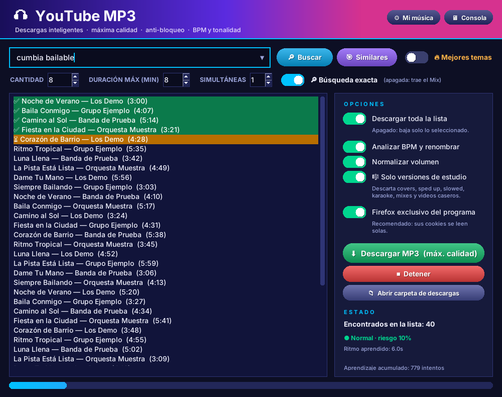

# YouTube MP3

Descargador de música de YouTube a MP3 con interfaz de escritorio (Python / Tkinter), pensado para DJs.

## Características
- Máxima calidad de audio disponible.
- Sistema anti-bloqueo que aprende: ritmo adaptativo, cookies de Firefox automáticas y firma de navegador coherente (impersonate).
- Búsqueda exacta, "Mejores temas" (YouTube Music) y filtro de **solo versiones de estudio**.
- Análisis de **BPM y tonalidad (Camelot)**; nombres limpios `[128 BPM] [8A] Artista - Título.mp3`, etiquetas ID3 y portada.
- Normalización de volumen sin recomprimir.
- Cola reanudable si se cierra el programa a mitad de una descarga.

## Requisitos
- Windows con Python 3.10 o superior.
- ffmpeg (carpeta `ffmpeg/` junto al programa).
- Dependencias: `pip install -r requirements.txt`  
  (o ejecutar `descargar_dependencias_youtube.py`).

## Uso
Ejecutar `youtube_Mp3.pyw` (doble clic).

## ⚠️ Aviso legal
Este programa es solo una herramienta técnica. **El uso indebido queda bajo la total responsabilidad
de quien lo utiliza**: descargá únicamente contenido propio, de dominio público, con licencia libre
o para el que tengas permiso. Descargar de YouTube puede violar sus Términos de Servicio.
Leé el [AVISO_LEGAL.md](AVISO_LEGAL.md) completo antes de usarlo.

## Licencia
[MIT](LICENSE), sujeta al aviso legal anterior. Software entregado "tal cual", sin garantías.
